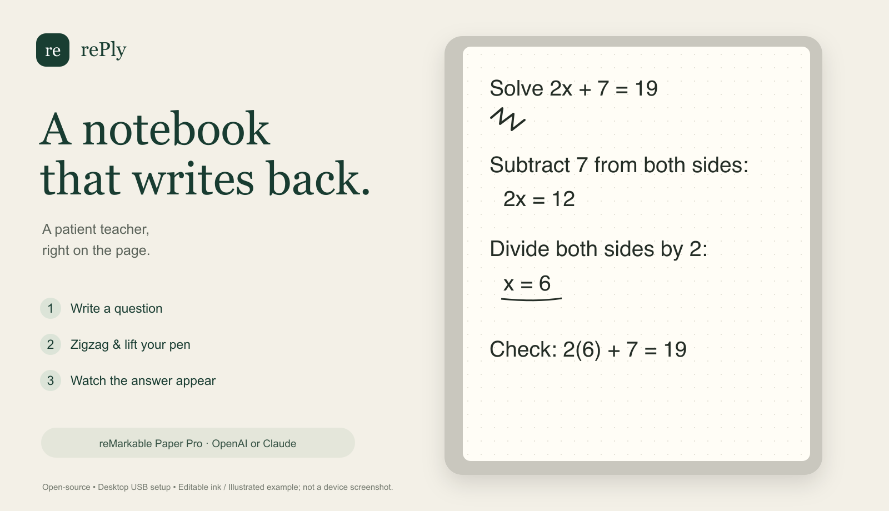

# rePly

**A notebook that writes back.** Handwrite a question on reMarkable Paper Pro, finish with a zigzag, and watch the answer appear as editable black ink.

rePly connects your paper tablet directly to OpenAI or Claude. The desktop app handles USB installation and API settings. Once set up, your tablet uses Wi-Fi; your computer can disconnect.

## What it does

- Answers handwritten questions and solves problems with worked steps.
- Draws answers live using medium Fineliner ink, with readable spacing.
- Renders tables and supported diagrams; continues long answers by scrolling and adding pages.
- Sends with a zigzag after you lift the pen, or with the toolbar wand.
- Keeps simple answers short and gives explanations when needed.
- No gesture animation in this public edition.

## Download and install

Download the ZIP for your computer from [**Releases**](https://github.com/vudh-dev/rePly/releases), extract it, and launch **rePly**. No Python, Node or command-line setup is required for the packaged app.

| Computer | Package |
| --- | --- |
| Mac with Apple silicon | `darwin-arm64.zip` |
| Mac with Intel processor | `darwin-x64.zip` |
| Windows 64-bit | `win32-x64.zip` |
| Linux Intel/AMD 64-bit | `linux-x64.zip` |
| Linux ARM64 | `linux-arm64.zip` |

This is an **unsigned beta**. macOS builds are ad-hoc signed, not notarized; Windows builds are not code-signed. Your OS may require explicit approval to open an app from an unidentified developer. Do not disable system security globally. Linux desktop dependencies vary by distribution.

1. **Back up your notebooks.** Enabling developer mode factory-resets the tablet and removes local data. Confirm your backup is usable first.
2. Follow the [official developer-mode instructions](https://developer.remarkable.com/documentation/developer-mode): Settings → General → Paper Tablet → Software → Advanced → Developer Mode.
3. Connect the tablet directly to your computer with a data-capable USB cable. Keep it awake and connected to Wi-Fi.
4. Find the SSH password in Settings → General → Help → About → Copyrights and Licenses → General Information.
5. Open rePly. Connect with that password and confirm the USB tablet's SSH fingerprint.
6. Select OpenAI or Claude, enter your **own API key**, choose a model, and install. API usage is billed by your provider; a ChatGPT/Claude subscription is separate.
7. When prompted, unlock the tablet and open a notebook to finish firmware indexing. The app may restart the tablet interface and require another unlock.
8. In a disposable notebook, write `What is 7+8?`, then a separate zigzag, and lift the pen. The answer should appear as ink.

After a reboot, reconnect USB and click **Start**. This beta deliberately uses a temporary startup override. **Return to previous setup** unloads rePly and restores prior startup settings; it does not erase notebooks.

## Compatibility

**Paper Pro (Ferrari), firmware 3.29.0.153 or 3.29.1.0 only.** The installer refuses other hardware/firmware because native ink integration depends on internal APIs. Paper Pro Move, reMarkable 1 and 2 are not supported. Do not downgrade firmware to use this beta. Firmware updates can require rebuilding and retesting the integration.

The original tablet pipeline was tested on the author's Paper Pro. The separate public installer and Claude integration need end-to-end beta testing. macOS packaging is checked locally; Windows and Linux packages are cross-built and have not been run on those systems. See [release checks](docs/RELEASE.md).

## Providers

| Capability | OpenAI | Claude |
| --- | --- | --- |
| Read handwritten pages | Yes, with a vision-capable model | Yes, with a vision-capable model |
| Text, tables, supported local diagrams | Yes | Yes |
| Live ink output | Yes | Yes, after the full API response arrives |
| Web search | Supported, model permitting | Not in this beta |
| Raster image generation | Separate OpenAI image call | Not in this beta |
| Reasoning effort control | Low / medium / high where supported | Not exposed in this beta |

Defaults are `gpt-5-mini` at low reasoning and `claude-haiku-5-5`. Model availability depends on your account; you can enter another compatible model ID. The key-check button verifies credentials and looks for the model; it does not prove vision/structured-output compatibility.

This release starts with a generic assistant. It does **not** include the author's personal context, Physics tutor, notebook mappings, lesson history, API keys or wallpaper. Advanced profile/history code remains in the source for contributors but has no setup UI and is not a supported cross-provider feature yet.

## Privacy and safety

The app has no analytics or project-operated server. Requests go from the tablet to the selected provider. Page screenshots can include surrounding handwriting: use a notebook whose contents you are comfortable sending. Keys are sent over SSH and stored in a root-readable configuration file on the tablet, not in the desktop app's settings. They are not encrypted at rest. Developer mode changes the tablet's security protections.

Native ink insertion uses undocumented tablet APIs. Use backups and test in disposable notebooks before using important documents. See [privacy](docs/PRIVACY.md), [recovery](docs/SETUP.md) and [security reporting](SECURITY.md).

## Build and contribute

See [BUILD.md](docs/BUILD.md). Contributions should include a firmware/device version and a reproducible test. Do not attach personal notebook captures, API keys, SSH passwords or unredacted logs to issues.

GPL-3.0-only. Credits and dependency licenses are in [THIRD_PARTY.md](THIRD_PARTY.md). An independent community project, unaffiliated with reMarkable, OpenAI, Anthropic or the owners of the rePly name.
